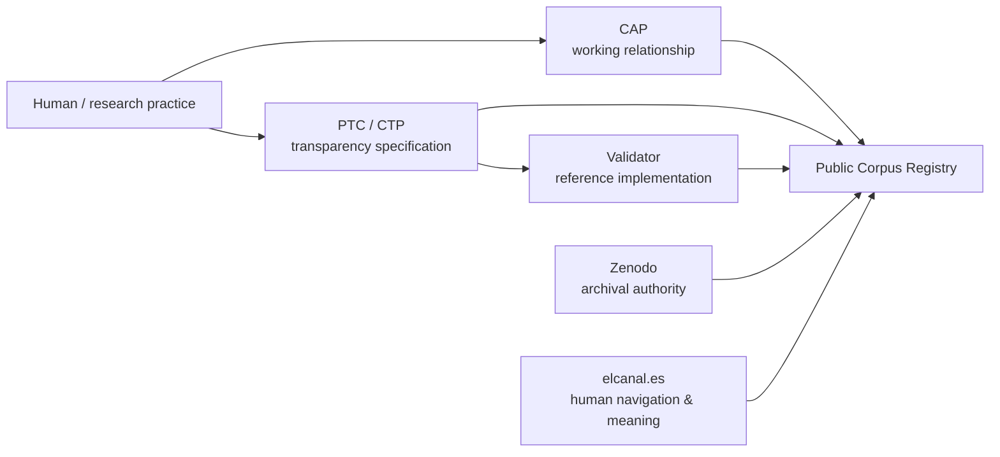

# El Canal — Applied Cognitive Symbology (ACS)

A public research and technical ecosystem for **longitudinal human–AI collaboration, transparency, traceability and human agency**.

This GitHub profile is the technical entrance to the project. It is intentionally smaller and more practical than the full public corpus at [elcanal.es](https://elcanal.es).

> **El Canal proposes. The human decides.**  
> **El Canal propone. El humano decide.**

## Start here

| If you want to… | Start with |
|---|---|
| Work with an LLM over time without making the relationship depend on one model, one memory system or one provider | **[CAP — Canal Activation Protocol](https://github.com/ulaulaygpt/elcanal-cap)** |
| Declare and inspect how AI participated in a document or digital artefact | **[PTC / CTP — Canal Transparency Protocol](https://github.com/ulaulaygpt/ptc-ctp)** |
| Create or verify a PTC declaration in practice | **[Validator — Reference Implementation](https://github.com/ulaulaygpt/ptc-validator)** · [validator.es](https://validator.es) |
| Explore the public corpus, DOIs, versions and relations between published artefacts | **[El Canal Public Corpus Registry](https://github.com/ulaulaygpt/elcanal-corpus)** |
| Understand the wider conceptual and historical project | **[elcanal.es](https://elcanal.es)** |

## The architecture in one view

The layers have different jobs:

- **CAP** governs the working relationship: state, context, memory discipline, epistemic separation and human control.
- **PTC/CTP** governs transparent declaration and verifiable traceability of AI participation.
- **Validator** implements PTC/CTP.
- **El Canal Corpus** makes the public ecosystem machine-readable and exposes DOI/version/relationship structure.
- **Zenodo** remains the archival and citation authority for closed releases.
- **elcanal.es** is the human-facing conceptual map.

## What this is not

This is **not** an autonomous-agent framework, a prompt marketplace, a RAG stack or a "productivity ×10" toolkit.

The project is for people who need a small, inspectable method for long-running human–AI work and, when necessary, a reproducible way to disclose and verify AI participation.

## Current technical stack

| Component | Current public version | Canonical DOI |
|---|---:|---|
| CAP | v0.3 | [10.5281/zenodo.23138399](https://doi.org/10.5281/zenodo.23138399) |
| R-01 | v1.1 | [10.5281/zenodo.21406620](https://doi.org/10.5281/zenodo.21406620) |
| PTC-F | v1.2 | [10.5281/zenodo.21406680](https://doi.org/10.5281/zenodo.21406680) |
| ARCH | v0.3 | [10.5281/zenodo.21406665](https://doi.org/10.5281/zenodo.21406665) |
| FRS-01 | v0.3 | [10.5281/zenodo.21830122](https://doi.org/10.5281/zenodo.21830122) |
| PKG-02 | v0.4 | [10.5281/zenodo.21830169](https://doi.org/10.5281/zenodo.21830169) |
| DCL-03 | v0.3 | [10.5281/zenodo.21830264](https://doi.org/10.5281/zenodo.21830264) |
| Validator | v1.1 | [10.5281/zenodo.21833853](https://doi.org/10.5281/zenodo.21833853) |

See **[VERSIONS.md](VERSIONS.md)** for status notes and **[GLOSSARY.md](GLOSSARY.md)** for the vocabulary used across repositories.

## Repository map

### [elcanal-cap](https://github.com/ulaulaygpt/elcanal-cap)
Minimal operational protocol for a conscious, portable and non-dependent human–LLM relationship. Start with `activacion.md`.

### [ptc-ctp](https://github.com/ulaulaygpt/ptc-ctp)
Normative specifications for the Canal Transparency Protocol: R-01, PTC-F, ARCH, FRS-01, PKG-02 and DCL-03.

### [ptc-validator](https://github.com/ulaulaygpt/ptc-validator)
Readable source mirror of Validator v1.1, synchronized from the SHA-256-verified canonical Zenodo package.

### [elcanal-corpus](https://github.com/ulaulaygpt/elcanal-corpus)
Machine-readable registry of the public corpus. It separates the public website view, Zenodo archival metadata, a merged catalogue and an explicit DOI relation graph.

## Publication model

A simple rule is used across the technical repositories:

**Zenodo preserves. GitHub exposes and versions. elcanal.es explains and connects.**

Only public, closed and unambiguous material belongs here. Drafts, private operator memory, credentials, sensitive operational material and ambiguous candidates are excluded.

## Author and project

**Manuel Barrera Anglada**  
ORCID: [0009-0000-8891-7021](https://orcid.org/0009-0000-8891-7021)  
Project: **El Canal — Applied Cognitive Symbology (ACS)**  
Website: [https://elcanal.es](https://elcanal.es)
